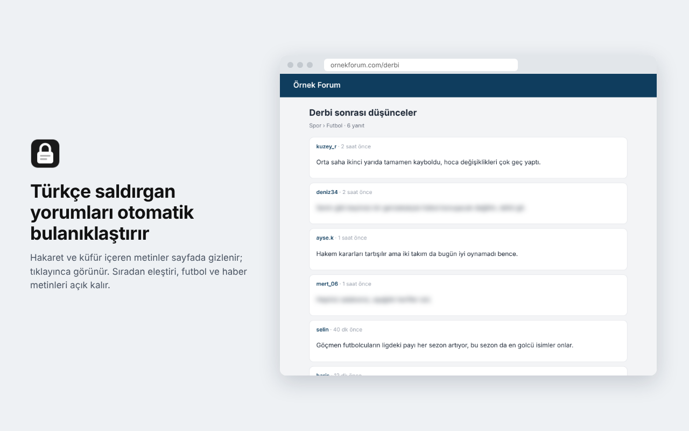

# LockNet

**Türkçe saldırgan metinleri tarayıcıda, cihaz üzerinde bulanıklaştıran Chrome eklentisi.**

LockNet, açtığın sayfalardaki Türkçe hakaret ve küfür içeren metinleri bulanıklaştırır; tıklayınca metin görünür. Türkçe BERT modeli eklentinin içinde, WebAssembly ile çalışır. Okunan metinler hiçbir sunucuya gönderilmez.



> *English summary at the bottom.*

## Öne çıkanlar

- **Cihazda çıkarım:** 41 MB'lık int8 ONNX BERT modeli, [onnxruntime-web](https://www.npmjs.com/package/onnxruntime-web) ile MV3 offscreen sayfasında çalışır; tarayıcıda cümle başına ~18 ms.
- **Tek ön işleme, iki dil:** Türkçe küçük harf, leet çözme (`s4l4k` → `salak`), harf tekrarı ve araya boşluk koyma gibi kaçamaklar Python'da ve JavaScript'te aynı kodla işlenir. ~4.000 metinlik eşlik testi iki tarafın birebir aynı sonucu verdiğini CI'da doğrular.
- **Ayrı web test seti:** Model yalnızca OffensEval'de değil, Türkçe haber, forum ve sözlük sitelerinden toplanıp elle etiketlenen 478 metinde de ölçüldü.
- **Sunucusuz eğitim:** Bütün modeller GitHub Actions üzerinde, `workflow_dispatch` ile eğitildi; sonuçlar ve model dosyaları otomatik commit'lendi.

## Sonuçlar

Veri: [OffensEval-2020 Türkçe](https://huggingface.co/datasets/coltekin/offenseval2020_tr) (Çöltekin, 2020; 31.756 eğitim, 3.528 test tweet'i, %19 saldırgan). Eşikler eğitim verisinden ayrılan %10'luk doğrulama setinde seçildi; test seti her model için bir kez ölçüldü. Makro F1, iki sınıfın F1 ortalamasıdır.

| Model | Boyut | OffensEval makro F1 | OffensEval AUC | Web AUC | Zor örnek |
|---|---|---|---|---|---|
| TF-IDF (hashing) + lojistik regresyon | 2 MB | 0.774 | 0.872 | 0.912 | 30/30 |
| Karakter + kelime CNN | – | 0.700 | 0.805 | – | – |
| Türkçe BERT tiny | 4,5 MB | 0.775 | 0.877 | 0.932 | 27/30 |
| Türkçe BERT mini | 11 MB | 0.787 | 0.893 | 0.949 | 28/30 |
| Türkçe BERT small | 28 MB | 0.789 | 0.901 | 0.926 | 30/30 |
| **Türkçe BERT medium (eklentide)** | **41 MB** | **0.804** | **0.911** | **0.966** | **30/30** |
| BERTurk base (yalnızca referans) | 106 MB | 0.821* | 0.929* | – | 28/30 |

BERT satırları, tarayıcıya giden int8 modelin sonuçlarıdır. \*BERTurk'ün int8 hali eklentiye sığmadığı için fp32 sonucu verildi. Yayımlanmış referans: BERTurk 0.816, CNN 0.751, SVM 0.685 (Çöltekin, 2020). Türkçe BERT modelleri: [ytu-ce-cosmos](https://huggingface.co/ytu-ce-cosmos) (Kesgin vd., 2023).

**Web test seti** (478 metin, 40'ı saldırgan; yanlış alarm, rastgele seçilen 313 metin üzerinden):

| Mod (medium) | Saldırganları yakalama | Rastgele metinde yanlış alarm |
|---|---|---|
| Dengeli | %70 | %2,0 |
| Temkinli | %60 | %1,0 |

40 saldırgan örnekle bir metin, yakalama oranında 2,5 puanlık fark yaratır; bu sayılar kabaca okunmalı.

Bütün ölçümler [`results/`](results) klasöründe. Web setindeki cümleler forum ve sözlük kullanıcılarının yazıları olduğu için depoya konmadı; yalnızca toplu ölçümler var.

## Öğrendiklerim

1. **Model, eğitildiği veriyle ölçülünce yetmez.** OffensEval tweet'lerden oluşuyor, eklenti ise haber ve forum sayfalarında çalışıyor. Web test setinde taban model futbol haberlerini ve "Müslüman", "göçmen" gibi kimlik terimleri geçen temiz cümleleri saldırgan buldu (*identity term bias*). Bunu OffensEval'deki sayılardan görmek mümkün değildi.
2. **Daha çok veri her zaman daha iyi değil.** Projenin ilk sürümünde kullanılan ek veri setleri, tanımı farklı etiketler ve yalnızca saldırgan örneklerde geçen gerçek kullanıcı adları içeriyordu. Model "kullanıcı adı varsa saldırgan" kısa yolunu öğrenmişti. Yeni sürüm yalnızca OffensEval'le eğitildi; ek veri web setinde de bir şey kazandırmadı.
3. **int8 dinamik nicemleme, parti komşularına bağlı skor üretir.** Etkinleşme ölçeği bütün tensörden hesaplandığı için aynı cümle farklı partilerde 0,4'e varan farklı skor aldı. Tarayıcı ile Python, her cümle tek başına puanlanınca birebir aynı sonucu verdi ([`onnx_skor.py`](training/locknet/onnx_skor.py)).
4. **Nicemleme ayarı ölçülerek seçilmeli.** Ağırlıkları kanal başına ölçeklemek, medium'un int8'e geçerken doğrulama setinde kaybettiği makro F1'i 1,4 puandan 0,7 puana indirdi.
5. **Büyük model her zaman gerekli değil.** BERTurk'ün 2,6 kat küçüğü olan medium, fp32'de yakın bir skor aldı (0.815 ve 0.821; aynı modelin ilk eğitiminde 0.819).

## Sınırlamalar

- İroniyi, imayı ve yazım hatalı küfürleri (`kopekler`) kaçırabilir.
- Sert ama hakaret içermeyen şikâyetleri ara sıra gizleyebilir.
- Yalnızca Türkçe için eğitildi.
- Uzun paragraflar ~200 karakterlik parçalara bölünür. Bir parça saldırgan bulunursa bütün blok gizlenir.

## Kurulum

### Eklentiyi denemek

1. Depoyu indir: `git clone https://github.com/melisayalcinkaya/LockNet_extension.git`
2. Chrome'da `chrome://extensions` → **Geliştirici modu** → **Paketlenmemiş öğe yükle** → `extension/` klasörünü seç.

### Eğitim ve testler

```bash
pip install -r training/requirements.txt
python -m pytest training/tests          # Python–JS eşlik testleri (Node 18+ gerekir)
python training/scripts/train_baseline.py
pip install -r training/requirements-train_bert.txt
python training/scripts/train_bert.py ytu-ce-cosmos/turkish-medium-bert-uncased medium
python scripts/paketle.py                 # dist/locknet-<sürüm>.zip
```

Sunucuda eğitmek için: **Actions → Egitim → Run workflow**; `betik` = `train_bert.py`, `arguman` = `ytu-ce-cosmos/turkish-medium-bert-uncased medium`.

## Mimari

```
sayfa ─▶ content.js ──(metin blokları)──▶ background.js ──▶ offscreen.html
           ▲  IntersectionObserver,                           skorlayici.js
           │  MutationObserver                                ├─ preprocess.js
           └──────────(skorlar)───────────────────────────────├─ wordpiece.js
                       eşik ≥ ? → bulanıklaştır               └─ onnxruntime-web (wasm)
```

| Klasör | İçerik |
|---|---|
| `extension/` | Chrome eklentisi (MV3) |
| `extension/lib/` | Ön işleme, WordPiece tokenizer, TF-IDF taban modeli (JS) |
| `training/locknet/` | Ön işleme, özellikler, veri, metrikler (Python) |
| `training/scripts/` | Eğitim, web verisi toplama, değerlendirme betikleri |
| `training/tests/` | Birim ve Python–JS eşlik testleri |
| `results/` | Bütün modellerin ölçümleri (JSON) |
| `.github/workflows/` | CI ve sunucuda eğitim |

## Gizlilik

Metinler yalnızca cihazda işlenir. Ayrıntılar: [PRIVACY.md](PRIVACY.md).

## Lisans

[MIT](LICENSE). Model, [ytu-ce-cosmos/turkish-medium-bert-uncased](https://huggingface.co/ytu-ce-cosmos/turkish-medium-bert-uncased) (MIT) üzerine OffensEval-2020 Türkçe (CC BY 4.0) ile ince ayar yapılarak eğitildi.

---

## English summary

LockNet is a Chrome extension (MV3) that blurs offensive Turkish text on web pages, running a fine-tuned Turkish BERT (int8 ONNX, 41 MB) fully on-device with onnxruntime-web, so no text leaves the browser. The model was trained on OffensEval-2020 Turkish via GitHub Actions. It reaches 0.804 macro-F1 on the official test set (BERTurk reference: 0.821 at 2.6× the size) and 0.966 ROC-AUC on a separate, hand-labeled set of 478 Turkish news, forum and dictionary-site texts, with about 1–2% false alarms on random web text. Preprocessing (Turkish casing, leetspeak, character repetition) and tokenization are implemented in both Python and JavaScript, with parity tests in CI. Notable findings: identity-term bias that only showed up on web data, and dynamic int8 quantization making scores depend on batch neighbours, fixed by scoring one sentence at a time.

**Author:** Melisa Yalçınkaya · melisa.yky2001@gmail.com
